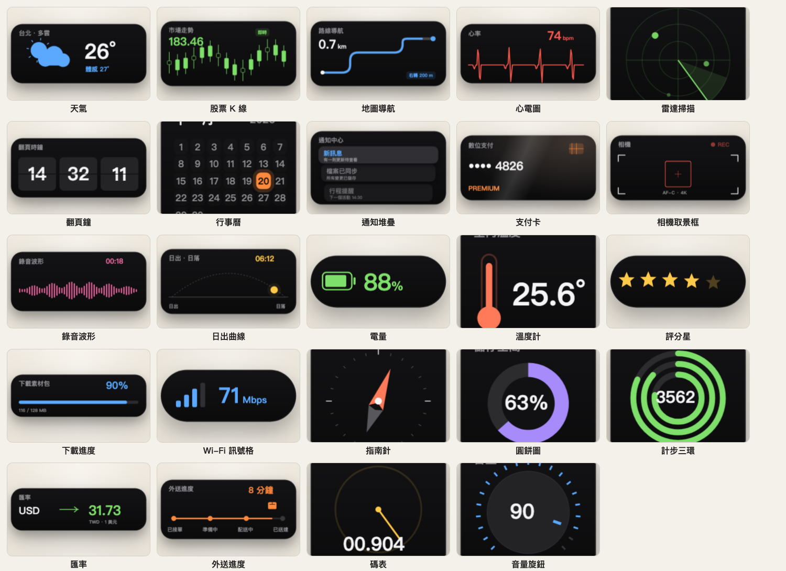

# motion-showcase

72 個動態元件，讓 AI 幫你放進網頁。心率、比分、進度環、圖表都能換成你的資料。


## 安裝 → 說需求 → 開啟網頁

**① 安裝**　在專案資料夾的終端機貼上：

```bash
npx skills add josenjc9/motion-showcase-skill --skill motion-showcase
```

依提示選你的 AI 工具 → 選 **Project** → 其餘用預設值。需先安裝 [Node.js 22.20+](https://nodejs.org/) 與 [Git](https://git-scm.com/downloads)。

**② 使用**　開一個新的 AI 對話，貼上：

```text
使用 motion-showcase，幫我做一個心率卡片和進度環的互動展示，完成後告訴我怎麼開啟。
```

**③ 看結果**　用 Chrome 開啟 AI 產生的 HTML，就能操作。

[不用指令，手動安裝](docs/install.md#不用指令手動安裝) · [Codex／Hermes 安裝與排錯](docs/install.md)

## 還有哪些元件？

### 生活與工具



### 進階元件


## 只想先看動態

[下載 ZIP](https://github.com/josenjc9/motion-showcase-skill/archive/refs/heads/main.zip) → 解壓縮 → 用 Chrome 開啟 `gallery.html`。保留整個資料夾，不需安裝套件。

[全部元件與資料欄位](catalog.md) · [手動寫 HTML](docs/first-widget.md) · [更新資料與操作教學](docs/tutorial.md)

元件顯示你提供的資料，不會自動接 API，也不會直接輸出 MP4。授權：[MIT](LICENSE)。
