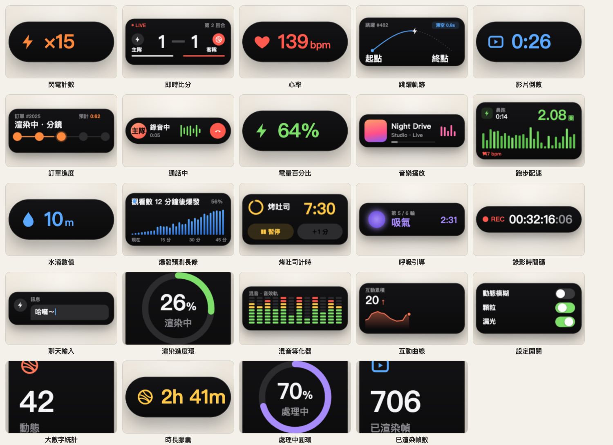

# motion-showcase

做短影音用的動態效果包。直式畫面，一共 104 種：72 個會動的小元件，加上進場、破壞、排列、鏡頭、轉場效果。

裝好之後，跟 AI 說「用 motion-showcase 做一段……」，它會幫你挑效果、預覽、輸出。

怎麼裝、怎麼用：[docs/tutorial.md](docs/tutorial.md)
成品範例（4 秒、三段串接）：[docs/sample-three-segments.mp4](docs/sample-three-segments.mp4)

## 先看效果
下載後雙擊 **`gallery.html`**，所有效果都會自己動，每個下面都有名字，不用裝任何東西。

## 一、進場（8 種）
元件怎麼出現。
3D 彈出、翻牌進場、彈跳落下、旋轉縮放、對焦浮現、擦除揭露、圓形遮罩、殘影滑入。

## 二、破壞特效（8 種）
元件怎麼被拆掉。
玻璃碎裂、方塊爆破、像素崩壞、時間切片、撕開畫面、扯畫面、RGB 色散、粒子溶解。

## 三、排列（3 種）
多個元件怎麼排：堆疊展開、卡片洗牌、元件轉盤。

## 四、鏡頭運動（4 種）
整個畫面怎麼動：拉焦、荷蘭角推近、無限套娃、俯拍旋轉。

## 五、轉場（9 種）
兩個畫面怎麼切換：ink（墨水擴散）、blinds（橫百葉）、vblinds（直百葉）、whip（甩鏡）、punch（衝擊放大）、glitch（故障位移）、flash（閃白）、iris（圓形擴張）、rgb（色散切換）。

## 六、動態元件（72 個）
可以單獨用，也能搭配上面的效果。

**基礎元件（24）**

**生活與工具類（24）**

**進階類（24）**

## 檔案
| 檔 | 用途 |
|---|---|
| `lib/` | 所有效果的程式 |
| `gallery.html` | 全部效果展示頁（雙擊開） |
| `examples/` | 三段串接範例與一鍵輸出影片 |
| `demo.html` | 預覽單一效果（進階） |
| `catalog.md` | 全部效果與編號 |
| `selftest.html` | 檢查每個效果都能正常顯示 |

只在 Chrome 測過，輸出影片需要 Chrome 與 ffmpeg（macOS、Linux）。不含音效與配樂。

授權：MIT
