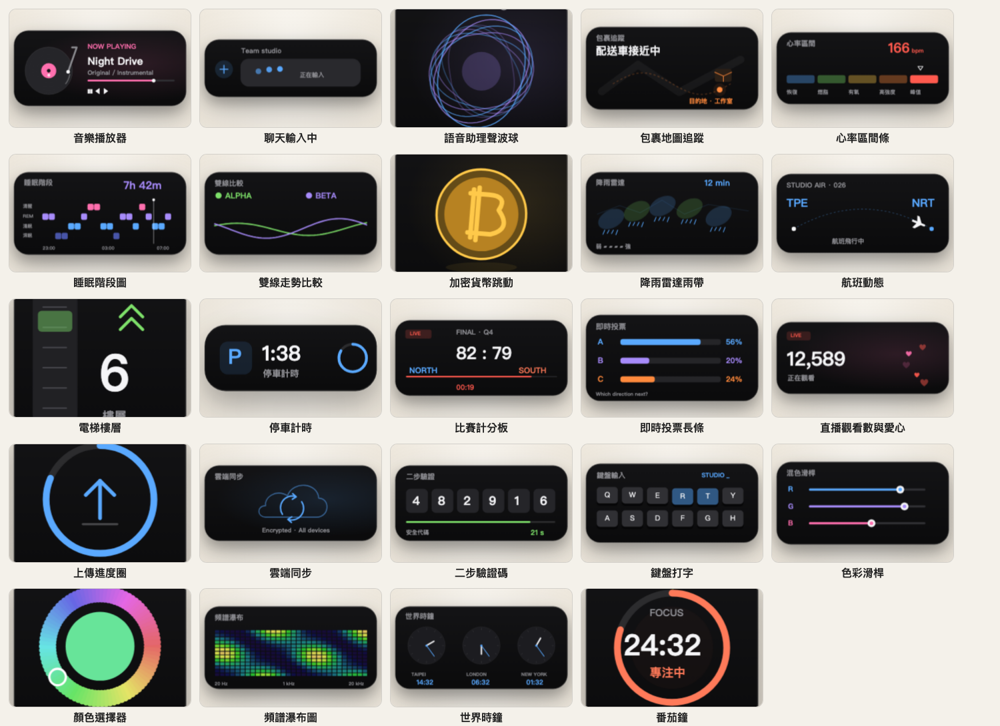

# motion-showcase

72 個動態元件，讓 AI 幫你放進網頁。

## 安裝 / 下載

在你的專案資料夾開啟終端機，選你用的工具，複製一行：

**Codex**
```bash
npx skills add josenjc9/motion-showcase-skill --skill motion-showcase -a codex
```

**Claude Code**
```bash
npx skills add josenjc9/motion-showcase-skill --skill motion-showcase -a claude-code
```

**[直接下載 ZIP](https://github.com/josenjc9/motion-showcase-skill/archive/refs/heads/main.zip)** · [手動安裝](docs/install.md#不用指令手動安裝)

需有 [Node.js 22.20+](https://nodejs.org/) 與 [Git](https://git-scm.com/downloads)；安裝選項保留預設即可。

## 開始用

在 Codex 或 Claude Code 開啟同一個專案、新增對話，貼上：

```text
使用 motion-showcase，幫我做一個心率卡片和進度環的互動展示，完成後告訴我怎麼開啟。
```

用 Chrome 開啟 AI 產生的 HTML，就能操作。Claude 這裡指能讀取專案的 **Claude Code**，不是一般聊天網頁。

## 元件預覽

### 基礎元件


### 生活與工具


### 進階元件


想看動態：下載 ZIP → 解壓縮 → 用 Chrome 開啟 `gallery.html`，保留整個資料夾。

[安裝排錯](docs/install.md) · [元件目錄](catalog.md) · [手動寫 HTML](docs/first-widget.md) · [操作教學](docs/tutorial.md)

元件不會自動接 API，也不會直接輸出 MP4。授權：[MIT](LICENSE)。
