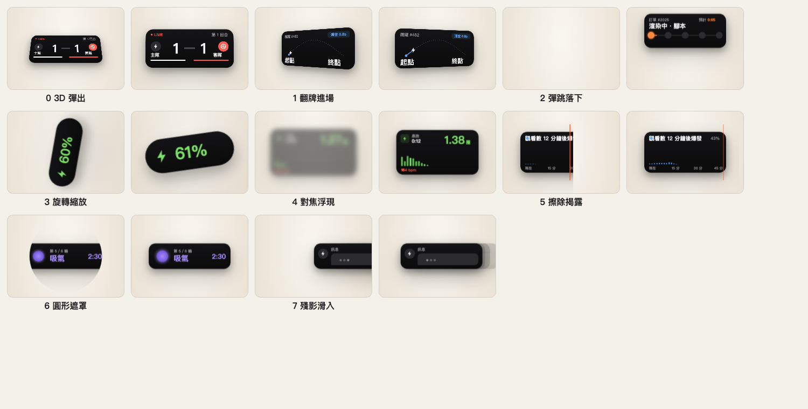
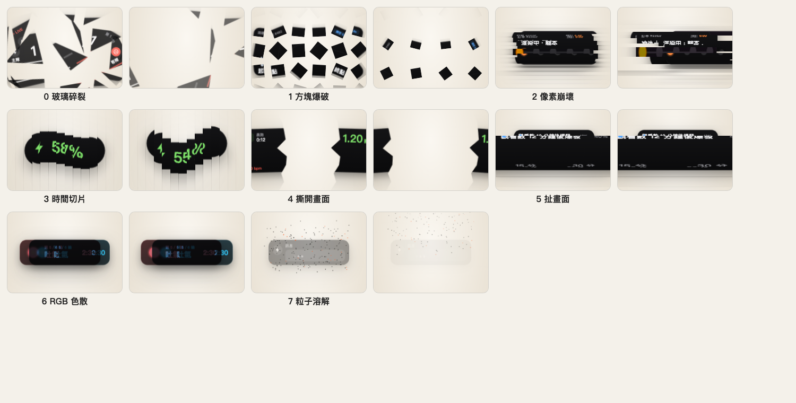
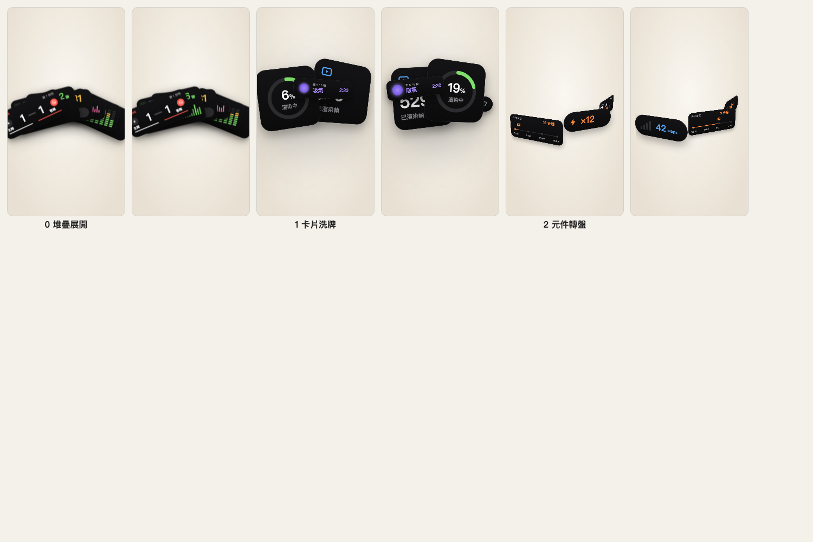
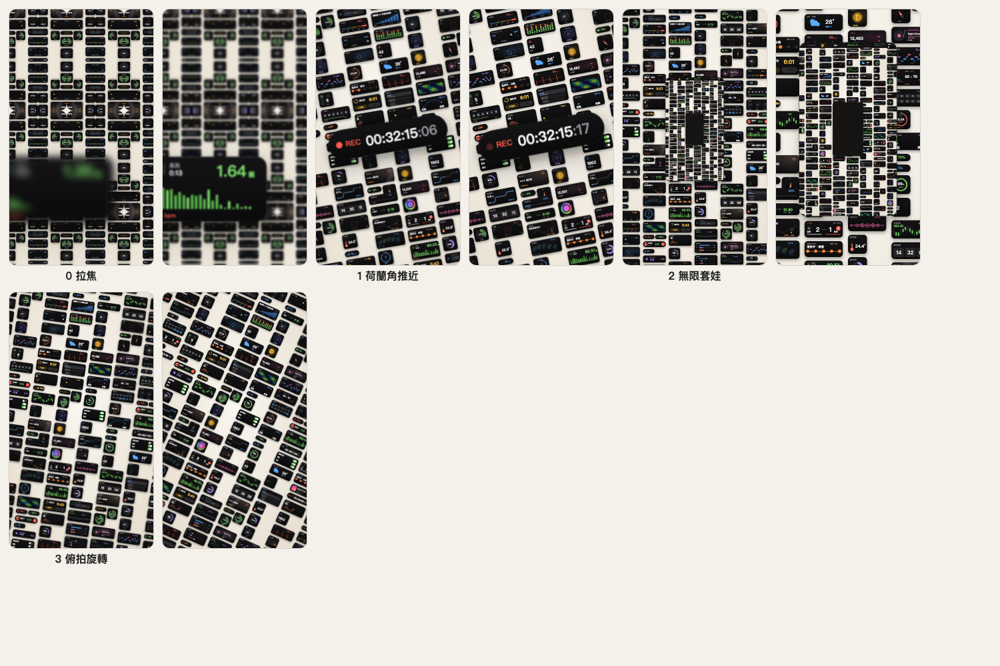
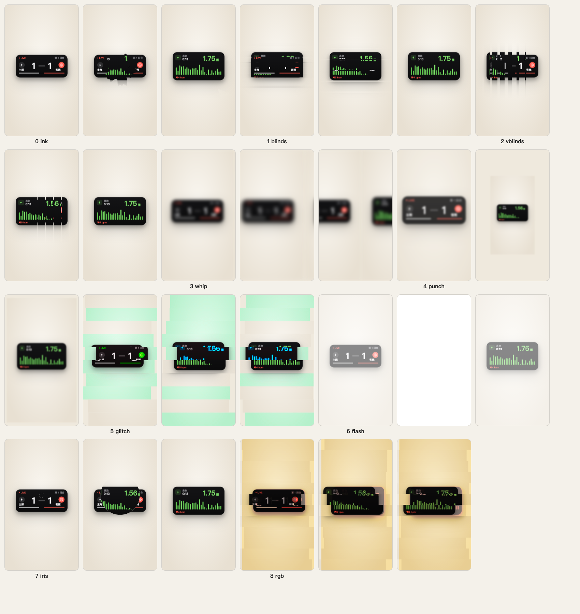
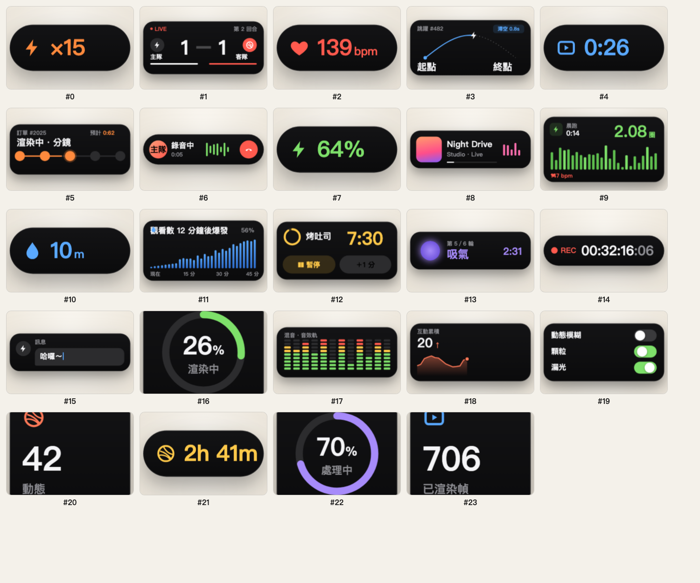
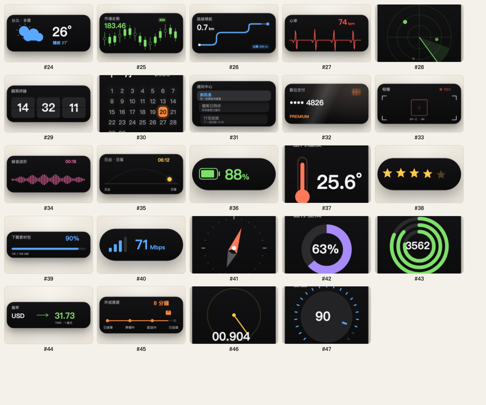
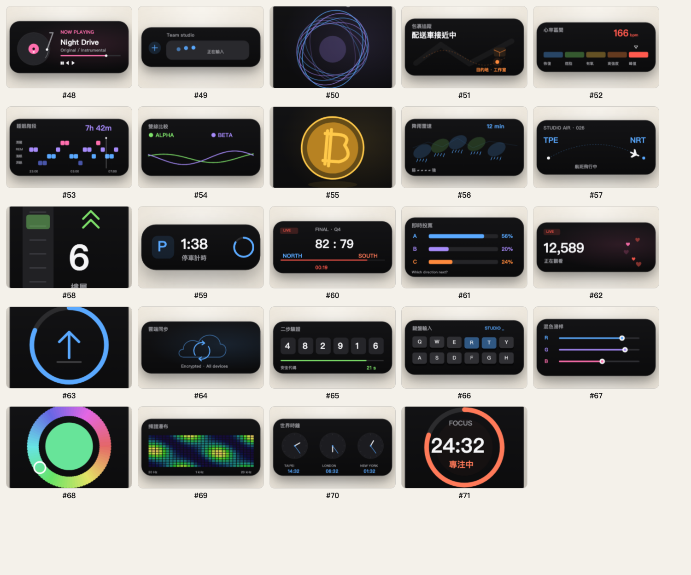
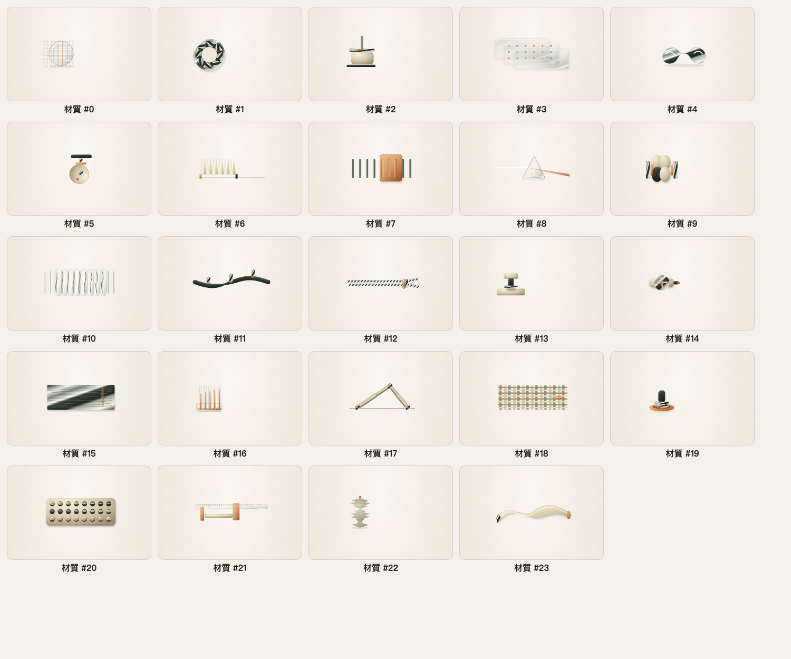

# motion-showcase

直式（1080×1920）動態視覺招式庫。純 HTML／CSS／JS，沒有圖片、字型、音檔相依。每一招都是「給時間 t（秒）→ 回傳一段 HTML」，所以能逐幀渲染、結果固定，適合做短影音、元件展示、產品動態。

**共 128 招**：96 個動態元件、8 進場、8 破壞特效、3 排列、4 鏡頭運動、9 轉場。
裝成 skill 後，直接跟 AI 說「用 motion-showcase 做一段……」，它會查目錄、挑招式、預覽、渲染。
完整教學看 [docs/tutorial.md](docs/tutorial.md)，招式編號看 [catalog.md](catalog.md)。

## 5 分鐘上手
1. 把整個資料夾放到 `~/.claude/skills/motion-showcase/`（Claude Code）。
2. 用瀏覽器直接開檔案預覽，不需要安裝任何東西：
   - `demo.html?type=break&i=1&t=0.3` → 方塊爆破的某一瞬間
   - `demo.html?type=widget&i=30&t=1` → 第 30 號動態元件在第 1 秒
3. 想看整類招式的總覽圖：`sheet.html?type=enter&ts=0.1,0.25`

---

## 一、進場（8 種）
元件怎麼「出現」：彈出、翻牌、落下、旋轉縮放、對焦、擦除、圓形遮罩、殘影。每招約 0.38 秒走完，每格圖是同一招的兩個時間點。

呼叫：`demo.html?type=enter&i=<編號>&t=<秒>&k=<用哪個元件>`

## 二、破壞特效（8 種）
元件怎麼「被拆掉」：玻璃碎裂、方塊爆破、像素崩壞、時間切片、撕開畫面、扯畫面、RGB 色散、粒子溶解。

呼叫：`demo.html?type=break&i=<編號>&t=<秒>&k=<元件>`

## 三、排列（3 種）
多個元件怎麼「站位」：堆疊展開、卡片洗牌、元件轉盤。

## 四、鏡頭運動（4 種）
整個畫面怎麼「動」：拉焦、荷蘭角推近、無限套娃、俯拍旋轉。

## 五、轉場（9 種）
兩個畫面怎麼「切換」：ink、blinds、vblinds、whip、punch、glitch、flash、iris、rgb。每格是同一個轉場進度 25%、50%、75%。

呼叫：`demo.html?type=transition&i=<編號>&t=<0 到 1 的進度>`

## 六、動態元件（72 個）＋材質元件（24 個）
可以單獨用，也是上面所有招式作用的對象。

**#0–23 基礎元件**

**#24–47 生活與工具類**

**#48–71 進階類**

**材質元件 0–23**（物理機械感：光圈、夾具、拉鍊、稜鏡等）

---

## 檔案
| 檔 | 用途 |
|---|---|
| `lib/widgets.js`、`widgets2.js`、`widgets3.js` | 72 個動態元件 |
| `lib/widgets4.js` | 24 個材質元件 |
| `lib/widgets-all.js` | 合併成同一張 WALL 清單 |
| `lib/motion.js` | 進場、破壞、排列、鏡頭、轉場與共用函式 |
| `demo.html` | 單招預覽頁 |
| `sheet.html` | 總覽圖產生頁 |
| `selftest.html` | 自我檢查，每招渲 3 個時間點，結果寫在頁面 |
| `catalog.md` | 招式目錄 |

## 限制
- 只在 Chrome（含無頭模式）實測。Safari／Firefox 沒測。
- 字型走系統字（PingFang TC、SF Pro），其他系統字型外觀會不同。
- 不含音效、配樂、實拍特效素材。

授權：MIT
